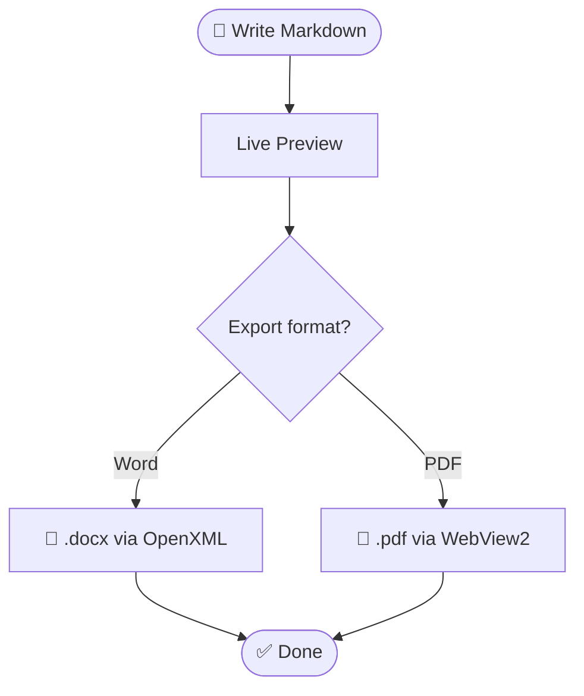
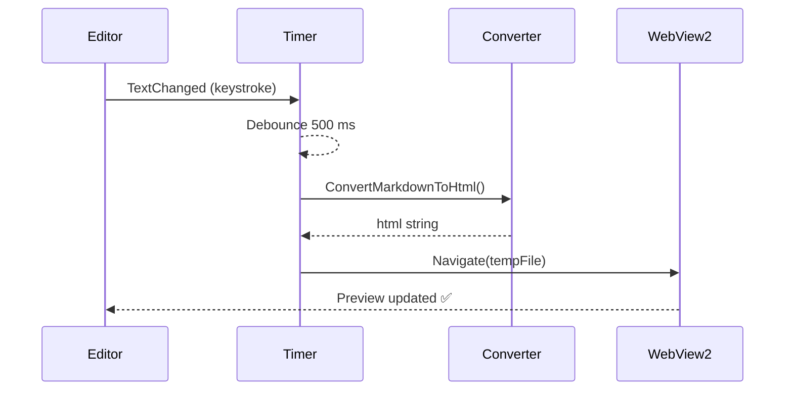
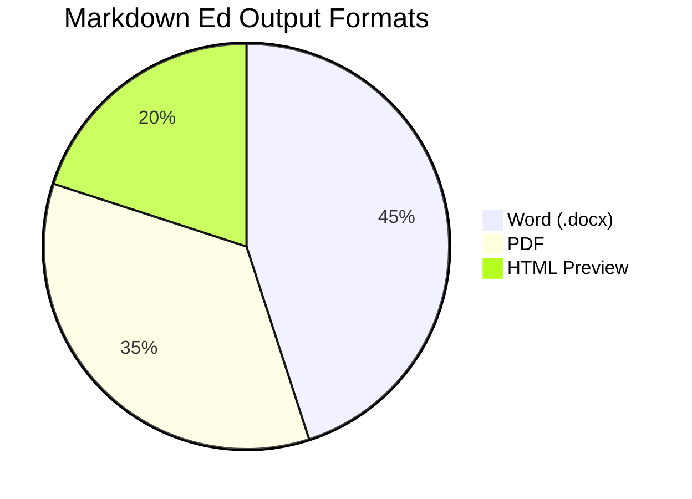

# 📝 Welcome to Markdown Ed!

[link text](image.png "Optional title")

**Markdown Ed** is a powerful, modern Markdown editor for Windows that converts your documents to professional **Word** files (.docx) and **PDF** documents with full formatting preservation.

> [!TIP]
> **Quick Tip**: Press `F5` to refresh the live preview, or use the toolbar buttons for instant formatting! Changing languages? Go to **File → Language**.

---

## ✨ Core Features

### 📄 Document Management
- Create, open, and save Markdown files (`.md`, `.markdown`, `.txt`)
- **Export to Word (.docx)** with professional styling
- **Export to PDF** for easy sharing and printing
- **Multilingual Support**: Switch between English and Français
- Auto-save backup (`.bak`) files for safety
- Smart handling of large files (chunked loading)
- Track unsaved changes with visual indicators

### 🎨 Text Formatting

**Emphasis and Style:**
- **Bold text** using `**double asterisks**`
- *Italic text* using `*single asterisks*`
- ***Bold and italic*** using `***triple asterisks***`
- ~~Strikethrough~~ using `~~double tildes~~`
- ==Highlight== using `==double equals==` (extension)
- `Inline code` using backticks

**Special Formatting:**
- Superscript: x^2^ + y^2^ = z^2^ (Pythagorean theorem)
- Subscript: H~2~O (water molecule), CO~2~ (carbon dioxide)
- Text can be **bold _and italic_** or _italic **and bold**_

### 📋 Lists

#### Ordered Lists
1. First level item
2. Another first level item
   1. Nested second level (2.1)
   2. Another second level (2.2)
      1. Third level nesting (2.2.1)
      2. Deep nesting works! (2.2.2)
3. Back to first level

#### Unordered Lists
- Main bullet point
  * Sub-item with asterisk
  + Sub-item with plus sign
  - Sub-item with hyphen
- Another main point
  - Nested point
    - Deeply nested point

#### Task Lists (To-Do) ✅
- [x] Download Markdown Ed
- [x] Open the application
- [x] Try the sample content
- [ ] Create your first document
- [ ] Export to Word format (.docx)
- [ ] Share with colleagues
  - [x] Email the team
  - [ ] Upload to SharePoint
  - [ ] Present in meeting

### 💻 Code Blocks

Inline code: Use `markdownEditor.Text` property to access content.

**C# Code Block:**
```csharp
public class MarkdownDocument
{
    public string Title { get; set; } = "Untitled";
    public string Content { get; set; } = string.Empty;
    public DateTime Modified { get; set; } = DateTime.Now;

    public async Task<bool> SaveAsync(string path)
    {
        await File.WriteAllTextAsync(path, Content);
        return true;
    }
}
```

**Python Example:**
```python
def convert_markdown_to_word(input_file, output_file):
    """Convert Markdown to Word document."""
    with open(input_file, 'r', encoding='utf-8') as f:
        content = f.read()
    
    # Process and convert
    converted = process_markdown(content)
    save_as_word(converted, output_file)
    
    return True
```

**JSON Configuration:**
```json
{
  "editor": {
    "fontSize": 11,
    "fontFamily": "Consolas",
    "wordWrap": true,
    "theme": "dark"
  },
  "export": {
    "pageSize": "A4",
    "margins": "1.0in",
    "includePageNumbers": true
  }
}
```

### 💬 Blockquotes

> **Standard Quote**
> 
> This is a simple blockquote that demonstrates the basic formatting.
> It can span multiple lines and will be styled appropriately.

> **Nested Quotes**
> 
> Sometimes you need to quote within quotes:
> 
> > "The best way to predict the future is to invent it."
> > — Alan Kay
> >
> > > Deep nesting is also supported!

> **Quotes with Formatting**
> 
> - Quotes can contain **bold** and *italic* text
> - They can have `code snippets`
> - Even links: [Markdown Guide](https://www.markdownguide.org)
> 
> ### And Headers!
> Code blocks work too:
> ```
> console.log("Inside a quote!");
> ```

### 📊 Tables

**Basic Table with Alignment:**

| Feature | Status | Priority | Notes |
|:--------|:------:|:--------:|------:|
| Markdown Editing | ✅ Complete | High | Syntax highlighting |
| Word Export | ✅ Complete | High | Full formatting |
| Dark Mode | ✅ Complete | Medium | System-aware |
| Find/Replace | 🚧 Coming Soon | Medium | Ctrl+F shortcut |
| Spell Check | 📋 Planned | Low | Future release |

**Keyboard Shortcuts:**

| Action | Windows | Description |
|:-------|:-------:|:------------|
| Save | `Ctrl+S` | Save current document |
| Open | `Ctrl+O` | Open file dialog |
| New | `Ctrl+N` | Create new document |
| Bold | `Ctrl+B` | Toggle bold formatting |
| Italic | `Ctrl+I` | Toggle italic |
| Preview | `F5` | Refresh preview pane |

**Export Settings:**

| Page Size | Width × Height | Use Case |
|:----------|:--------------:|:---------|
| A4 | 210 × 297 mm | International standard |
| Letter | 8.5 × 11 in | US standard |
| Legal | 8.5 × 14 in | Legal documents |
| Paperback 6×9 | 6 × 9 in | Self-publishing |
| Custom | User-defined | Special requirements |

### 🔗 Links and References

**Link Types:**
- Regular inline link: [Microsoft Store](ms-windows-store://pdp/?productid=9NJPQL3NS23T)
- Link with tooltip: [Microsoft Store](https://apps.microsoft.com/store/detail/9NJPQL3NS23T "Markdown Ed on Microsoft Store")
- Reference-style link: [Markdown Guide][markdown-guide]
- Email link: <fahdev@proton.me>
- Auto-linked URL: https://www.markdownguide.org

**Image Examples:**


**Reference Definitions:**

[markdown-guide]: https://www.markdownguide.org "The definitive Markdown guide"
[github]: https://github.com "GitHub - Where the world builds software"

### 📝 Footnotes

Markdown Ed supports footnotes[^1] for additional information without cluttering the main text. You can add multiple footnotes[^2] and they'll be automatically numbered and linked.

Mathematical concepts[^math] and technical details[^tech] can be explained in footnotes, keeping your document clean and readable.

[^1]: Footnotes appear at the bottom of your Word document and are automatically hyperlinked.

[^2]: Each footnote reference is unique and can be referenced multiple times if needed.

[^math]: For example, explaining the quadratic formula: x = (-b ± √(b² - 4ac)) / 2a

[^tech]: Technical specifications: Markdown Ed is built with .NET 10, WinForms, and uses the Markdig parsing engine.

### ➗ Mathematical Expressions

**Inline Math:** The formula $E = mc^2$ represents Einstein's mass-energy equivalence.

**Block Math (Display Mode\):**

$$
\int_{a}^{b} f(x) \, dx = F(b) - F(a)
$$

$$
\sum_{i=1}^{n} i = \frac{n(n+1)}{2}
$$

$$
\lim_{x \to \infty} \frac{1}{x} = 0
$$

### 📊 Mermaid Diagrams

Markdown Ed renders **Mermaid diagrams** live in the preview. Just use a fenced code block with the `mermaid` language tag.

**Flowchart — Document Export Pipeline:**


**Sequence Diagram — Preview Refresh Flow:**


**Pie Chart — Supported Export Formats:**


### 📐 Horizontal Rules

You can create separators using three or more hyphens, asterisks, or underscores:

---

***

___

---

## 🎯 Getting Started

### Quick Start Guide

1. **Write your content** in the left editor pane ✍️
2. **Preview instantly** in the right pane (auto-updates as you type) 👀
3. **Use the toolbar** for quick formatting:
   - **B** for bold, *I* for italic, **H1-H6** for headings
   - **Table Editor** 📊 and **Emoji Picker** 😊 for rich content
4. **Export Your Work** 📤:
   - Click **Export to Word** for a styled document.
   - Click **Export to PDF** for a fixed-layout file.
5. **Language Settings** 🌐: Go to **File → Language** to switch the UI.

### Pro Tips 💡

> [!NOTE]
> **Dark Mode**: The app automatically adapts to your Windows light/dark theme.

> [!IMPORTANT]
> **Table Editing**: Use the Table button (📊) to open an interactive editor. You can easily add/remove rows and adjust column alignment without writing raw Pipes syntax.

> [!TIP]
> **Cleanup Tools**: If you copy text from the web, use **Tools → Clean Invisibles** to remove hidden Unicode characters that can break formatting.

---

## 🔧 Advanced Features

### Text Cleanup

The **Tools** menu provides utilities to:
- Remove invisible Unicode characters (zero-width spaces, etc.)
- Clean up multiple consecutive spaces
- Normalize line endings

### Special Characters

**HTML Entities:**
- © Copyright symbol
- ™ Trademark symbol
- ® Registered trademark
- — Em dash
- (non-breaking space)

**Escaped Characters:**
- Backslash: \\
- Backtick: \`
- Asterisk: \*
- Underscore: \_
- Brackets: \[ \]
- Parentheses: \( \)

### YAML Front Matter

```yaml
---
title: "My Document"
author: "Your Name"
date: 2026-01-09
tags: [markdown, documentation, writing]
version: 1.0
---
```

---

## 📚 Resources

### Learn More
- 📖 [Markdown Guide](https://www.markdownguide.org)
- 📖 [CommonMark Specification](https://commonmark.org)
- 📖 [GitHub Flavored Markdown](https://github.github.com/gfm/)

### About This Application
- **Version:** See Help → About for version information
- **Technology:** .NET 10, WinForms, AvalonEdit, WebView2
- **Markdown Engine:** Markdig with advanced extensions
- **Word Export:** OpenXML SDK (DocumentFormat.OpenXml)

---

## 🎉 Emoji Showcase

Thanks to **Unicode.net** integration, Markdown Ed supports full emoji rendering! 🎊

### Popular Emojis

**Smileys & Emotion:**
😀 😃 😄 😁 😆 😅 🤣 😂 🙂 🙃 😉 😊 😇 🥰 😍 🤩 😘 😗 😚 😙 😋 😛 😜 🤪 😝 🤑

**Gestures:**
👍 👎 👏 🙌 👐 🤲 🤝 🙏 ✍️ 💪 🦾 🦿 🦵 🦶 👂 🦻 👃 🧠 🦷 🦴 👀 👁️ 👅 👄

**Animals & Nature:**
🐶 🐱 🐭 🐹 🐰 🦊 🐻 🐼 🐨 🐯 🦁 🐮 🐷 🐸 🐵 🐔 🐧 🐦 🐤 🦆 🦅 🦉 🦇 🐺 🐗

**Food & Drink:**
🍎 🍊 🍋 🍌 🍉 🍇 🍓 🫐 🍈 🍒 🍑 🥭 🍍 🥥 🥝 🍅 🍆 🥑 🥦 🥬 🥒 🌶️ 🌽

**Activities & Sports:**
⚽ 🏀 🏈 ⚾ 🥎 🎾 🏐 🏉 🥏 🎱 🏓 🏸 🏒 🏑 🥍 🏏 🥅 ⛳ 🏹 🎣

**Travel & Places:**
🚗 🚕 🚙 🚌 🚎 🏎️ 🚓 🚑 🚒 🚐 🚚 🚛 🚜 🦯 🦽 🦼 🛴 🚲 🛵 🏍️ 🛺 🚔

**Objects:**
⌚ 📱 💻 ⌨️ 🖥️ 🖨️ 🖱️ 🖲️ 🕹️ 🗜️ 💾 💿 📀 📼 📷 📸 📹 🎥 📞 ☎️ 📟 📠 📺

**Symbols:**
❤️ 🧡 💛 💚 💙 💜 🖤 🤍 🤎 💔 ❣️ 💕 💞 💓 💗 💖 💘 💝 ✨ 💫 ⭐ 🌟 ✔️ ✅ ❌

---

## 🚀 Start Creating!

You're now ready to create professional Markdown documents! 

- Type your content in the **editor** (left pane) ✍️
- See the **live preview** (right pane) 👁️
- **Export to Word** when ready 📤
- **Save your work** frequently (Ctrl+S) 💾

**Happy Writing! 📝✨**

*Created with Markdown Ed - Transform your ideas into beautiful documents* 💼
